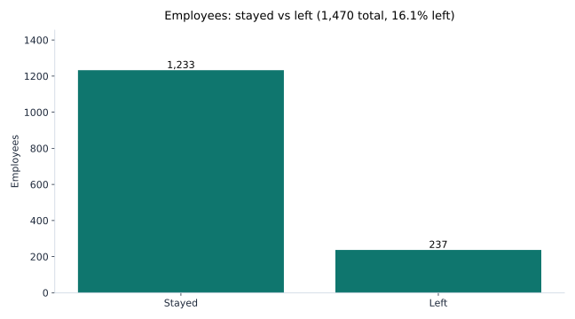
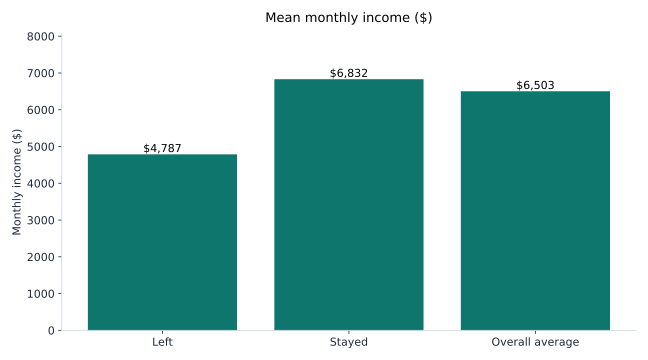

# Employee Attrition Analysis

I worked as a Data Analyst at JEEVIKA in Bihar for three years. There I saw what happens when good people leave a team. It costs time. It costs money. And the team that stays has to carry the work.

So I wanted to understand why people leave. I used this dataset to practise that question. 237 out of 1,470 employees left. I wanted to know who they were.

## What I found

237 people left. That is 16.1%. 1,233 stayed.

The people who left earned less. That is the part that stayed with me.

People who left earned $4,787 a month on average. People who stayed earned $6,832. That is a 42.7% gap. One published analysis of this dataset calls it statistically significant. The average across everyone was $6,503.

And it is not about performance. In one published dashboard built on this dataset, attrition was 16.4% among employees rated Outstanding and 16.1% among those rated Excellent. About the same as everyone else. The company is losing good people, not weak ones.

The notebook also breaks attrition down by department, job role, overtime, years at the company, and monthly income band. So the risky groups can be named, not guessed at.

## What I would do about it

1. Look at overtime first. It is usually the cheapest problem to fix.
2. Review pay for the roles and departments where most people leave.
3. Support new joiners in their first two years if they leave fastest.
4. Stop treating attrition as a performance problem. Top rated employees leave at the same rate as everyone else.

## The data

IBM HR Analytics Employee Attrition and Performance dataset, from Kaggle:
https://www.kaggle.com/datasets/pavansubhasht/ibm-hr-analytics-attrition-dataset

1,470 employees, 35 columns, one row per employee. No missing values. The columns cover demographics, pay, job details, satisfaction scores, and tenure.

Please read this first. This dataset is simulated data made by IBM for education and practice. It is not a real company's workforce. Everything here is an exercise. It shows how I analyse attrition. It says nothing about any real employer.

## How to run it

1. Download `WA_Fn-UseC_-HR-Employee-Attrition.csv` from the Kaggle link above and put it in the `data/` folder. See `data/DATA_SOURCE.md`.
2. `pip install -r requirements.txt`
3. Open `notebooks/01-attrition-analysis.ipynb` and run it top to bottom.
4. The SQL queries in `sql/attrition_queries.sql` answer the same questions in SQLite.

## What this does not prove

- Simulated data. Nothing here describes a real employer.
- These are patterns, not causes. Low pay and overtime go with leaving, but the data cannot prove one causes the other.
- It is one snapshot in time. There is no trend over years.

## Tools

Python (pandas, matplotlib), SQL (SQLite).

## About me

Lovely Kumari. Data Analyst. M.S. in Information Systems from Rider University. Based in Jersey City, NJ. I build dashboards and reports in Python, SQL, and Power BI.
